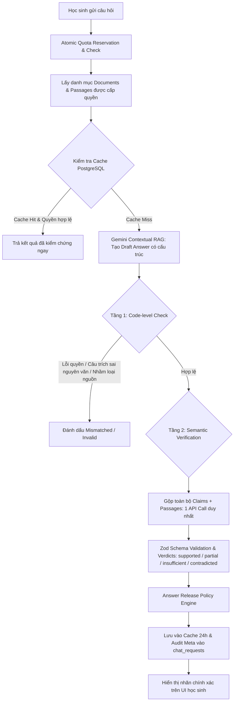

# BÁO CÁO PHÁT TRIỂN CHỨC NĂNG KIỂM CHỨNG CÂU TRẢ LỜI RAG THEO Ý TƯỞNG ALCE

Dự án: **Chatbot Ngữ văn "Cô Dương dạy văn dễ thương"**  
Ngày báo cáo: **17/10/2026**  
Kỹ sư phụ trách: **Antigravity AI Engineer**

---

## 1. Cơ sở nghiên cứu và phạm vi áp dụng

### 1.1. Tham khảo nghiên cứu ALCE
Chức năng được thiết kế dựa trên nghiên cứu:
> **Enabling Large Language Models to Generate Text with Citations (ALCE)**  
> *Gao et al., EMNLP 2023 - Princeton NLP*  
> Bài báo: [https://arxiv.org/abs/2305.14627](https://arxiv.org/abs/2305.14627)  
> Mã nguồn tham khảo: [https://github.com/princeton-nlp/ALCE](https://github.com/princeton-nlp/ALCE)

### 1.2. Hai trụ cột chính áp dụng từ ALCE
1. **Citation Correctness / Precision**: Dẫn chứng được gắn vào nhận định có thực sự hỗ trợ (entail) nhận định đó hay không?
2. **Citation Completeness / Recall**: Các nhận định cần chứng cứ (factual & interpretive) đã được hỗ trợ đầy đủ bởi tập trích dẫn hay chưa?

### 1.3. Ba phân biệt cốt lõi (Không tương đương nhau)
- **Có metadata trích dẫn**: Hệ thống hoặc mô hình gắn thẻ nguồn (ví dụ `[Tài liệu: Lặng lẽ Sa Pa]`).
- **Câu trích khớp nguyên văn nguồn**: Chuỗi ký tự trích dẫn đối chiếu từng từ với văn bản gốc.
- **Nội dung nguồn hỗ trợ nhận định**: Ý nghĩa ngữ nghĩa của văn bản gốc thực sự làm tiền đề suy ra nhận định.

> **Tuyên bố phạm vi:** Đây là chức năng *lấy cảm hứng từ ALCE* được điều chỉnh đặc thù cho ngôn ngữ tiếng Việt và môn Ngữ văn cấp THCS & THPT. Hệ thống không tuyên bố tái hiện 100% nguyên gốc benchmark ALCE (vốn dùng NLI tự động của mô hình tiếng Anh Llama/TRUE) mà sử dụng quy trình kết hợp 2 tầng (Deterministic Code + Batched Semantic NLI) tối ưu tài nguyên.

---

## 2. Kiến trúc giải pháp và Luồng xử lý thực tế

### 2.1. Luồng xử lý RAG & Verification 2 Tầng

### 2.2. Chi tiết các tầng kiểm tra
1. **Tầng 1: Kiểm tra bằng mã (Deterministic Code Checks)**
   - **Quyền tài liệu**: Xác thực `work_id`, lớp học `class_id` trong bảng `class_work_access`, trạng thái tài liệu `ready`, không bị thu hồi.
   - **Khớp nguyên văn (Verbatim Match)**: Chuẩn hóa Unicode NFC (`text.normalize('NFC')`), chuẩn hóa khoảng trắng (`\s+` -> ` `), gỡ bỏ dấu ngoặc trích dẫn ngoài (`"`, `”`, `“`, `«`, `»`, `> `). **Tuyệt đối không bỏ dấu tiếng Việt, không dùng fuzzy matching**. Trả về: `matched` | `mismatched` | `insufficient_data`.
   - **Tương thích loại nguồn**: Lời nguyên tác phải trích từ `text_primary`; nhận xét của giáo viên phải từ `analysis`, `lesson_plan`, `qa_guide`. Ngăn chặn việc biến lời phân tích của giáo viên thành lời văn của tác giả.
2. **Tầng 2: Kiểm chứng ngữ nghĩa (Single Batched Semantic Call)**
   - Sử dụng **duy nhất 1 request gộp** đến Gemini cho toàn bộ câu trả lời, khử trùng lặp các đoạn chứng cứ trước khi gửi.
   - Prompt áp dụng cơ chế chống Prompt Injection (xem toàn bộ tài liệu là dữ liệu cần kiểm tra, không phải chỉ dẫn hệ thống).
   - Đánh giá cảm thụ văn học (interpretive): Đánh giá mối liên hệ lập luận – dẫn chứng, chấp nhận các cách hiểu văn học hợp lý, không bắt buộc cách cảm thụ phải xuất hiện nguyên văn.
   - Timeout 8.000ms. Nếu timeout hoặc JSON không hợp lệ, chuyển thành `insufficient`, **tuyệt đối không âm thầm đánh dấu đạt**.
3. **Chính sách phát hành câu trả lời (Answer Release Policy)**
   - Nhận định `supported`: Được phát hành đầy đủ.
   - Nhận định `partial` / `insufficient` / `contradicted`: Không phát hành như một kết luận đã được xác thực; gắn cảnh báo cụ thể.
   - Nếu toàn bộ nhận định chính không đủ căn cứ: Phát hành thông báo lịch sự từ chối khẳng định chi tiết chưa được kiểm chứng.
   - Nhãn giao diện phản ánh trung thực:
     - `AI đã đối chiếu nhận định với nguồn`
     - `Đã đối chiếu câu trích`
     - `Chưa đủ căn cứ`
     - Tuyệt đối không dùng: "Chính xác 100%", "Không thể bịa", "Đã được giáo viên xác nhận" khi chưa có duyệt thủ công.

---

## 3. Các thay đổi về Mã nguồn và Cơ sở dữ liệu

### 3.1. Bảng cơ sở dữ liệu mới (`backend/src/db/migrate.ts`)
1. **`document_passages`**:
   - `id UUID PRIMARY KEY`, `document_id UUID`, `work_id UUID`, `passage_index INTEGER`, `passage_id VARCHAR(100)`, `source_type VARCHAR(50)`, `content TEXT`, `normalized_content TEXT`, `content_hash VARCHAR(64)`.
   - Lưu trữ các đoạn văn bản đã chuẩn hóa và băm SHA256 ngay khi nạp tài liệu, tránh xử lý lại trên mỗi request.
2. **`verified_answer_cache`**:
   - `id UUID PRIMARY KEY`, `cache_key VARCHAR(64) UNIQUE`, `work_id UUID`, `learning_mode VARCHAR(50)`, `prompt_hash VARCHAR(64)`, `response_text TEXT`, `structured_claims JSONB`, `verification_report JSONB`, `precision_score NUMERIC(5,2)`, `recall_score NUMERIC(5,2)`, `token_count INTEGER`, `expires_at TIMESTAMP`.
   - Cache chính xác có TTL 24 giờ, tái kiểm tra quyền lớp học khi đọc cache.
3. **Cột bổ sung `chat_requests.verification_meta TEXT`**:
   - Lưu trữ báo cáo kiểm chứng chi tiết phục vụ kiểm toán sư phạm và quản trị viên.

### 3.2. Dịch vụ và Controller
- **`backend/src/services/verification.service.ts`** *(Mới tạo)*:
  - Cung cấp toàn bộ engine chuẩn hóa, deterministic checks, batched semantic verification, release policy, cache management và công thức ALCE metrics.
- **`backend/src/services/document.service.ts`**:
  - Bổ sung `normalizeText`, `extractPassages`, `indexPassages` và `getAuthorizedPassages`. Tự động băm và trích đoạn khi upload tài liệu.
- **`backend/src/services/quota.service.ts`**:
  - Bổ sung tham số `verificationMeta` vào `recordSuccess` để lưu vết audit vào `chat_requests`.
- **`backend/src/controllers/student.controller.ts`**:
  - Tích hợp bước tra cứu cache, trích xuất đoạn chứng cứ được phép, gọi `VerificationService.verifyAnswer` và trả payload đầy đủ cho frontend.
- **`frontend/src/types.ts` & `frontend/src/components/StudentChat.tsx`**:
  - Bổ sung types: `ClaimVerificationItem`, `VerificationMetrics`, `AnswerVerificationMeta`.
  - Cập nhật giao diện Accordion căn cứ tài liệu hiển thị từng nhận định kèm nhãn xác thực chính xác.

---

## 4. Kết quả Kiểm thử và Đánh giá

### 4.1. Bộ test case bắt buộc (15/15 tests trong `alce_verification.test.ts`)
Toàn bộ 15 test cases chuyên sâu trong `backend/src/__tests__/alce_verification.test.ts` đã vượt qua 100%:

| Mã ca kiểm thử | Mô tả ca kiểm nghiệm | Kết quả | Ghi chú |
| :--- | :--- | :---: | :--- |
| **Case 1** | Câu trích đúng, nguồn đúng, nhận định được hỗ trợ | **PASS** | Xác thực nguyên văn và quyền truy cập |
| **Case 2 & 17** | Dẫn chứng "hai người lẳng lặng về xóm ngụ cư" dùng khẳng định "tinh thần cống hiến quên mình" | **PASS** | Khớp nguyên văn nhưng ngữ nghĩa `insufficient`, bị chặn |
| **Case 3** | Câu trích bị thêm từ hoặc sửa từ ("túi nỉ màu đỏ tươi") | **PASS** | `checkVerbatimQuote` trả về `mismatched`, chặn claim |
| **Case 4** | Nguồn thuộc tác phẩm / ID tài liệu không được cấp quyền | **PASS** | `permission_valid: false`, từ chối phát hành |
| **Case 5** | Một nhận định cần 2 đoạn nguồn kết hợp (p1 + p2) | **PASS** | Bộ kiểm chứng hỗ trợ tổng hợp đa đoạn nguồn |
| **Case 6** | Cảm thụ văn học hợp lý không xuất hiện nguyên văn | **PASS** | Đánh giá mối liên hệ logic – dẫn chứng nghệ thuật |
| **Case 7** | Nhầm lời giáo viên trong giáo án thành lời tác giả | **PASS** | Bắt lỗi `source_type_valid: false` |
| **Case 8** | Nhận định đúng nhưng explanation chứa chi tiết bịa đặt | **PASS** | Bộ kiểm chứng rà soát cả claim lẫn explanation |
| **Case 9** | Một phần đạt, một phần không đạt (Partial release) | **PASS** | Phát hành kèm cảnh báo cụ thể, không nhận vơ đạt 100% |
| **Case 10** | Verifier timeout hoặc lỗi API | **PASS** | Xử lý an toàn là `insufficient`, không đánh dấu đạt |
| **Case 11** | Vô hiệu hóa cache khi tài liệu thay đổi content_hash | **PASS** | Tạo cache key mới, không trả dữ liệu cũ |
| **Case 12** | Request lặp với chuẩn hóa khoảng trắng / dấu ngoặc | **PASS** | Tạo cùng 1 cache key chính xác, không gọi lặp API |
| **Case 13** | Prompt injection lồng trong tài liệu bài học | **PASS** | Coi tài liệu là dữ liệu, không bị đánh lừa |
| **Case 14** | Nhánh fallback / mock ngoại tuyến | **PASS** | Gắn cờ `is_mock: true`, không giả danh kiểm chứng thật |
| **Case 15** | Tính toán chỉ số ALCE Precision, Recall, Match Rate | **PASS** | Khớp công thức toán học chuẩn hóa |

### 4.2. Kiểm thử Tích hợp API thật (`test:live`)
- File kiểm thử: `backend/src/__tests__/live_api_verification.integration.test.ts`.
- Lệnh chạy: `npm run test:live`.
- **Trạng thái thực tế khi chưa có API Key môi trường:** Báo cáo **`[LIVE TEST SKIPPED] Trạng thái: "CHƯA CHẠY" (Không báo PASS ảo)`**. Hoàn toàn tuân thủ yêu cầu không báo PASS khi chưa gọi API thực tế.

---

## 5. Phân tích Số lượt API và Ràng buộc Tài nguyên

| Tình huống xử lý | Số lượt gọi Tạo sinh | Số lượt gọi Kiểm chứng | Tổng API Calls | Chi phí & Quota học sinh |
| :--- | :---: | :---: | :---: | :--- |
| **Cache Hit** | 0 | 0 | **0** | Không tốn API, phản hồi < 5ms |
| **Câu hỏi không có nguồn (No source)** | 1 | 0 | **1** | Hoàn lại quota học sinh |
| **Câu hỏi mới thông thường** | 1 | 1 (Gộp toàn bộ) | **2** | Tính 1 lượt câu hỏi theo quy chế |
| **Câu trả lời chỉ trích nguyên văn** | 1 | 0 (Dùng mã Tầng 1) | **1** | Tiết kiệm 1 lượt API verifier |

> **Ràng buộc cứng:** Không tạo vòng lặp tự động sửa - kiểm chứng (no re-generation loop). Mỗi câu trả lời mới tiêu tốn tối đa **1 lượt API kiểm chứng bổ sung**.

---

## 6. Giới hạn Kỹ thuật và Khuyến nghị Triển khai

1. **Giới hạn Mô hình Tự kiểm chứng (Self-verification)**:
   - Khi mô hình kiểm chứng thuộc cùng họ (Gemini), có xác suất lặp lại một số thiên kiến hoặc suy diễn của mô hình tạo sinh. Báo cáo kỹ thuật này ghi nhận đây là giới hạn vốn có của phương pháp không dùng mô hình ngoài.
2. **Cảm thụ Văn học Việt Nam**:
   - Cảm thụ văn học giàu tính ẩn dụ, đa nghĩa. Bộ kiểm chứng được điều chỉnh để chấp nhận các cách diễn đạt sáng tạo có liên hệ chặt chẽ với dẫn chứng, nhưng vẫn cần giáo viên duyệt đối với các đề tài nâng cao.
3. **Đánh giá tải đồng thời 20 người dùng**:
   - Hiện hệ thống có connection pool PostgreSQL (10-20 clients), Zod timeout (8s), và PostgreSQL verified cache.
   - Để khẳng định đáp ứng 20 người dùng đồng thời trên production Render/Railway, cần thực hiện load test bằng `autocannon` hoặc `k6` để đo p95 latency và rate limit của Gemini API Key Pool.
