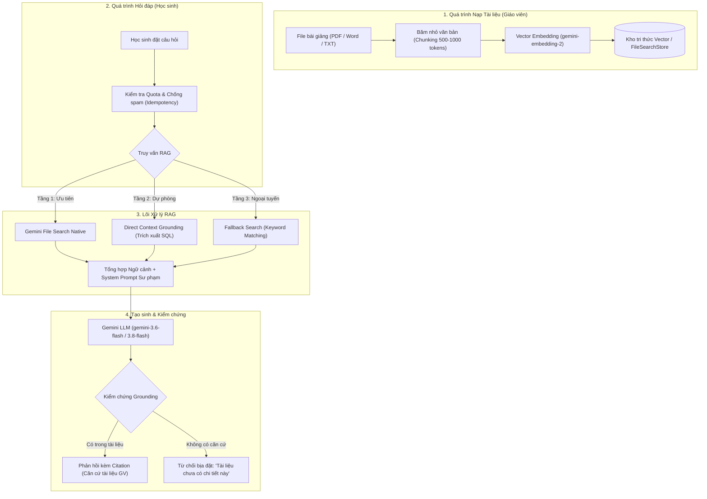

# BÁO CÁO KỸ THUẬT VỀ HỆ THỐNG RAG (RETRIEVAL-AUGMENTED GENERATION)
## Dự án: Trợ lý AI Ngữ Văn "Cô Dương dạy văn dễ thương"
**Thời gian lập báo cáo**: Tháng 10/2026  
**Chuyên đề**: Kiến trúc Truy xuất - Tăng cường - Tạo sinh (RAG) & Cơ chế Chống ảo giác (Anti-Hallucination)

---

## I. ĐẶT VẤN ĐỀ VÀ BẢN CHẤT CỦA RAG TRONG GIẢNG DẠY NGỮ VĂN

### 1. Hạn chế của LLM truyền thống trong môn Văn
Các mô hình ngôn ngữ lớn (như GPT, Gemini thuần túy) khi không có RAG thường gặp các nhược điểm nghiêm trọng:
* **Ảo giác kiến thức (Hallucination)**: Tự sáng tác những câu thơ không có trong nguyên tác, nhầm lẫn giữa các nhân vật (ví dụ: gán chi tiết của *Chí Phèo* sang *Vợ Nhặt*).
* **Lệch chuẩn chương trình giáo dục**: Phân tích theo các nguồn tư liệu trôi nổi trên Internet thay vì bám sát sách giáo khoa và giáo án giảng dạy của giáo viên.
* **Viết văn mẫu thay học sinh**: Làm thui chột khả năng tư duy và cảm thụ độc lập của người học.

### 2. Định nghĩa kiến trúc RAG
**RAG (Retrieval-Augmented Generation)** là cơ chế kỹ thuật kết hợp giữa:
1. **Retrieval (Truy xuất dữ liệu)**: Tìm kiếm các đoạn trích dẫn, luận điểm, tài liệu tham khảo chính thống từ kho bài giảng của cô giáo.
2. **Augmentation (Tăng cường ngữ cảnh)**: Đưa tài liệu vừa tìm được vào ngữ cảnh (prompt) kèm theo các quy tắc sư phạm khắt khe.
3. **Generation (Tạo sinh có căn cứ)**: AI phân tích và diễn đạt thành câu trả lời ấm áp, chuẩn mực, kèm trích dẫn nguồn xác thực.

---

## II. SƠ ĐỒ KIẾN TRÚC & PIPELINE VẬN HÀNH



---

## III. THIẾT KẾ PROMPT SƯ PHẠM & CÁC CHẾ ĐỘ HỌC TẬP (LEARNING MODES)

Hệ thống thiết lập nhân vật (Persona) **"Cô Dương dạy văn dễ thương"** với các quy chuẩn đạo đức sư phạm được lập trình sẵn tại `backend/src/services/gemini.service.ts`:

### 1. Nguyên tắc sư phạm cốt lõi (Pedagogical Guardrails)
1. **Xưng hô chuẩn mực**: Luôn xưng *"cô"*, gọi người học là *"em"*, giữ giọng điệu truyền cảm, ân cần.
2. **Tuyệt đối không bịa đặt**: Chỉ trả lời dựa trên nội dung được truy xuất từ tài liệu của tác phẩm. Nếu tài liệu giáo viên chưa có thông tin, bắt buộc thông báo lịch sự rằng hiện chưa có căn cứ, không dùng kiến thức bên ngoài để khẳng định.
3. **Không viết văn thay học sinh**: Đóng vai trò người gợi mở, hướng dẫn cách viết và phân tích, không tạo ra các bài văn mẫu hoàn chỉnh để học sinh chép.

### 2. Sáu chế độ học tập chuyên biệt
Hệ thống cho phép học sinh chọn phương pháp học tập theo nhu cầu:

| Chế độ | Mã (Code) | Đặc điểm xử lý RAG |
|:---|:---|:---|
| **Hỏi đáp tác phẩm** | `qa` | Giải đáp thấu đáo về hoàn cảnh sáng tác, cốt truyện, chi tiết nghệ thuật, trích dẫn chuẩn xác. |
| **Phân tích nhân vật** | `character_analysis` | Bắt buộc tuân theo **chuẩn 4 bước**: *1. Luận điểm -> 2. Dẫn chứng tài liệu -> 3. Phân tích nghệ thuật -> 4. Đánh giá tư tưởng*. |
| **Gợi ý dàn ý** | `outline` | Chỉ lập khung dàn ý (Mở bài - Thân bài - Kết bài) với các luận điểm và gợi ý dẫn chứng. Tuyệt đối không viết thành bài văn xuôi hoàn chỉnh. |
| **Luyện đọc hiểu từng bước** | `reading_comprehension` | Áp dụng phương pháp Socratic: chỉ hỏi hoặc gợi mở từng câu một, đợi học sinh trả lời rồi mới nhận xét và đi tiếp. |
| **Góp ý bài viết** | `essay_feedback` | Tôn trọng giọng văn của học sinh; khen ngợi 2-3 điểm tích cực trước; chỉ ra lỗi diễn đạt, thiếu dẫn chứng mà không viết lại bài văn. |
| **Chuẩn bị bài & Ôn tập** | `prep_and_review` | Truy xuất trực tiếp các câu hỏi trọng tâm và mục tiêu bài học do chính giáo viên lớp đó cấu hình. |

---

## IV. CƠ CHẾ CHỊU LỖI 3 TẦNG (MULTI-TIER RAG FALLBACK)

Nhằm đảm bảo hệ thống vận hành liên tục 24/7 ngay cả khi gặp sự cố mạng hoặc gián đoạn API từ Google, hệ thống áp dụng cơ chế 3 tầng tự động chuyển đổi:

### Tầng 1: Google Gemini Native File Search (Vector Store RAG)
* Sử dụng API chính thức của Google: `fileSearchStores.create` và `interactions.create`.
* Văn bản được lưu trữ và băm vector trên hạ tầng đám mây của Google với mô hình `gemini-embedding-2`.
* Tự động trả về tọa độ trích dẫn chính xác (`file_citation`) và vị trí đoạn văn bản gốc.

### Tầng 2: Direct Context Grounding (In-Prompt Chunked RAG)
* Kích hoạt khi tài liệu mới tải lên đang trong quá trình index (`Đang index...`) hoặc khi Native File Search gặp độ trễ.
* Hệ thống tự động trích xuất các đoạn văn bản (chunks) được lưu trữ tại cơ sở dữ liệu PostgreSQL của hệ thống, bơm trực tiếp vào ngữ cảnh của câu lệnh (`generateContent`).
* Vẫn đảm bảo 100% độ chính xác dựa trên tài liệu bài giảng của giáo viên.

### Tầng 3: Fallback Search (Ngoại tuyến / Giả lập)
* Kích hoạt khi hệ thống chưa cấu hình Gemini API Key hoặc khi toàn bộ các Key ngoài đều bị cạn hạn mức (Quota Exceeded 429).
* Sử dụng thuật toán quét từ khóa thông minh (TF-IDF / Text Matching) trên các trích đoạn văn bản có sẵn trong cơ sở dữ liệu để tìm câu trả lời chính xác, hiển thị nhãn *`Tài liệu giáo viên (Ngoại tuyến)`*.

---

## V. CƠ CHẾ GEMINI API KEY POOL & CÂN BẰNG TẢI

Để giải quyết triệt để lỗi **429 (Hết hạn mức Quota)** và **503 (Máy chủ AI quá tải)**, hệ thống xây dựng mô-đun Key Pool tiên tiến:

```
[Danh sách API Keys: Key 1, Key 2, Key 3, ...]
                      │
           Thuật toán Round-Robin
                      ▼
             Gọi Gemini Service
            /                 \
       (Thành công)         (Gặp lỗi 429 / 503)
            │                         │
     Trả kết quả RAG        Đưa Key vào COOLDOWN 60s
                            Tự chuyển sang Key kế tiếp
```

* **Round-Robin Load Balancing**: Phân phối đều các câu hỏi của học sinh qua danh sách các API Key được nạp.
* **Tự động cách ly (Cooldown)**: Nếu một key bị lỗi hạn mức (429), hệ thống tự động đánh dấu cách ly 60 giây và tự động thử lại bằng key tiếp theo ngay lập tức mà học sinh không nhận thấy sự gián đoạn.
* **Kiểm thử đa luồng (Health Check)**: Trang Admin cung cấp giao diện kiểm tra đồng thời tất cả các key, đo đạc thời gian phản hồi (ms) và trạng thái sẵn sàng.

---

## VI. BẢO VỆ CHỐNG LẠM DỤNG & GIÁM SÁT HỆ THỐNG

1. **Idempotency Key**: Mỗi câu hỏi của học sinh đều kèm một khóa định danh duy nhất (UUID/Hash). Nếu học sinh bấm gửi nhiều lần liên tiếp do mạng lag, hệ thống chỉ trừ 1 lượt quota và trả về đúng kết quả cũ.
2. **Quota Engine**: Quản lý số lượt hỏi bài hàng ngày (mặc định 20 câu/ngày/học sinh). Giáo viên có thể cấp thêm lượt (`extra_granted`) cho học sinh ôn thi.
3. **Audit Logging & Trích dẫn minh bạch**:
   * Mỗi phản hồi đều lưu vết mã tác phẩm, số lượng token tiêu thụ, trạng thái có nguồn trích (`hasCitations`) hay không.
   * Giao diện phía học sinh hiển thị thẻ:
     ```
     Căn cứ tài liệu giáo viên (1)  •  Google Gemini AI (gemini-3.6-flash)  •  RAG Grounded ✓
     ```

---

## VII. KẾT QUẢ ĐÁNH GIÁ & KIỂM THỬ THỰC TẾ

Toàn bộ logic RAG đã được kiểm chứng thông qua bộ kiểm thử tự động tại `backend/src/__tests__/rag_grounding.test.ts`:

* **Test 1: RAG Grounding Verification**: Kiểm tra câu hỏi có dẫn chứng trong tài liệu ("đội chiếu" trong *Vợ Nhặt*). Kết quả: Trả về chính xác dẫn chứng năm 1944-1945 và trích nguồn tài liệu.
* **Test 2: Anti-Hallucination Guardrail**: Kiểm tra câu hỏi không có trong tài liệu ("Tác phẩm có nhắc đến phi thuyền không?"). Kết quả: AI từ chối khẳng định và thông báo lịch sự không có căn cứ.
* **Test 3: Persona Check**: Đảm bảo AI luôn xưng "cô" và gọi "em", không xưng hô tùy tiện.
* **Test 4: Non-ghostwriting**: Kiểm tra chế độ dàn ý (`outline`), AI chỉ tạo cấu trúc luận điểm, không viết bài văn hoàn chỉnh.

**Kết luận**: Hệ thống RAG của dự án "Cô Dương dạy văn dễ thương" đã đạt chuẩn mực cao về tính sư phạm, độ tin cậy của dữ liệu và khả năng vận hành bền bỉ trong môi trường giáo dục thực tế.
