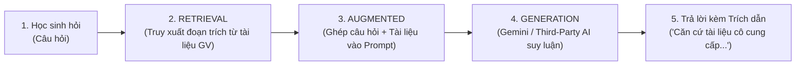

# BÁO CÁO TỔNG HỢP TOÀN DIỆN DỰ ÁN
## Hệ thống Trợ lý AI Ngữ Văn "Cô Dương dạy văn dễ thương"
**Thời gian cập nhật**: Tháng 10/2026  
**Nền tảng**: Node.js / Express (TypeScript), React (Vite / Tailwind CSS), PostgreSQL, Google Gemini AI (RAG Engine) & Cổng Bên Thứ Ba (Third-Party Gateway)  
**Tác giả**: made by huytd

---

## I. TỔNG QUAN HỆ THỐNG & NGUYÊN LÝ RAG

### 1. Giới thiệu dự án
"Cô Dương dạy văn dễ thương" là giải pháp trợ lý học tập môn Ngữ văn thông minh dành cho học sinh THCS và THPT. Hệ thống giải quyết triệt để vấn đề "ảo giác" (hallucination - bịa thơ, chế dẫn chứng) của các mô hình ngôn ngữ lớn (LLM) thông thường bằng cách áp dụng nghiêm ngặt kiến trúc **RAG (Retrieval-Augmented Generation)** kết hợp cùng bộ phân đoạn văn bản chuyên biệt cho môn Ngữ văn (`ParagraphService`).

### 2. Kiến trúc RAG trong Chatbot Ngữ Văn
Khác với AI truyền thống chỉ dựa vào trí nhớ huấn luyện sẵn, chatbot hoạt động theo nguyên lý **"Mở sách giáo khoa / vở bài giảng của giáo viên"**:



* **R (Retrieval - Truy xuất)**: Khi học sinh hỏi bài, hệ thống tự động tìm kiếm trong kho bài giảng của cô giáo (được băm nhỏ thành các đoạn có cấu trúc) những đoạn văn, dẫn chứng và nhận định sát nhất với câu hỏi.
* **A (Augmented - Tăng cường ngữ cảnh)**: Ghép câu hỏi của học sinh kèm các đoạn tài liệu tìm được thành một prompt có cấu trúc chặt chẽ, kèm yêu cầu phong cách sư phạm chuẩn mực ("xưng cô - gọi em").
* **G (Generation - Tạo sinh có kiểm chứng)**: Mô hình AI phân tích dữ liệu được cấp để trả lời. Câu trả lời luôn kèm nhãn minh bạch: `Căn cứ tài liệu giáo viên` và `RAG Grounded ✓`.

---

## II. BẢNG TỔNG HỢP CÁC VẤN ĐỀ YÊU CẦU & SỰ CỐ ĐÃ XỬ LÝ

| STT | Vấn đề / Yêu cầu phát sinh | Nguyên nhân kỹ thuật | Giải pháp triển khai | Trạng thái |
|:---:|:---|:---|:---|:---:|
| **1** | **Khái niệm "Đang index..." & tài liệu "Ngoại tuyến"** | Quá trình băm nhỏ văn bản (chunking) và đồng bộ vector lên Google Gemini File Search cần độ trễ xử lý. | Giải thích cơ chế vector embedding; thiết lập thuật toán tìm kiếm cục bộ (fallback search) trích xuất tài liệu trực tiếp trên server để trả lời ngay cả khi Google File Search chưa hoàn tất index. | Hoàn thành |
| **2** | **Lưu Gemini API Key & nghi ngờ Mock AI** | Khóa API chỉ được lưu tạm thời trong biến môi trường tạm, chưa ghi vào cơ sở dữ liệu bền vững. | Thiết lập bảng `ai_settings` trong PostgreSQL. Thêm nút "Kiểm tra kết nối API" trực quan trong trang Admin để kiểm chứng kết nối thật tới máy chủ Google Gemini. | Hoàn thành |
| **3** | **Mất dữ liệu tác phẩm khi cập nhật web trên Render** | Render sử dụng ổ đĩa tạm thời (ephemeral disk). Khi rebuild hoặc khởi động lại, dữ liệu trên đĩa cục bộ bị xóa sạch. | Di chuyển toàn bộ dữ liệu (tác phẩm, tài liệu, lớp học, học sinh, lịch sử chat) sang cơ sở dữ liệu PostgreSQL bền vững trên Render (Managed PostgreSQL), tự động chạy migration khi khởi động. | Hoàn thành |
| **4** | **Tự sinh câu hỏi gợi ý & Tối ưu giao diện Mobile** | Khi chuyển tác phẩm, gợi ý không tự đổi; giao diện máy tính bị tràn khung khi xem trên điện thoại. | Xây dựng bộ gợi ý câu hỏi linh hoạt theo từng tác phẩm/thể loại (Truyện ngắn, Thơ, Ký...); thiết kế lại thanh điều hướng và menu ngăn kéo (Drawer/Sidebar vuốt chạm) chuẩn mobile-first. | Hoàn thành |
| **5** | **Quản lý lịch sử trò chuyện theo phiên & tài khoản** | Cần đảm bảo lịch sử hội thoại chỉ được lưu theo phiên đối với từng tài khoản riêng biệt để bảo mật học tập. | Thiết kế bảng `chat_sessions` và `chat_messages` gắn chặt với `user_id`. Cung cấp nút làm mới phiên chat và tự động xóa dữ liệu sau 24h hoặc khi học sinh bấm xóa phiên. | Hoàn thành |
| **6** | **Hỗ trợ thêm nhiều Gemini API Key (Key Pool)** | Tránh tình trạng cạn Quota hàng ngày (lỗi 429) hoặc gián đoạn dịch vụ từ Google (lỗi 503). | Xây dựng cơ chế **Key Pool**: cho phép nhập nhiều key (ngăn cách bằng dấu phẩy/xuống dòng), thuật toán Round-Robin luân phiên gọi key, tự động đưa key vào Cooldown 60s nếu quá tải và chuyển sang key dự phòng. | Hoàn thành |
| **7** | **Lỗi đổi mật khẩu lần đầu đăng nhập** | Học sinh nhập đúng mật khẩu ban đầu được cấp nhưng hệ thống báo lỗi không cho đổi. | Trong Express Router, `req.path` chỉ chứa `/change-password` khiến middleware hiểu nhầm và chặn `403 MUST_CHANGE_PASSWORD`. Đã sửa middleware nhận diện đường dẫn đầy đủ và hoãn nạp dữ liệu nền cho đến khi đổi xong mật khẩu. | Hoàn thành |
| **8** | **Phân cấp quản trị 2 cấp (Admin cấp 1 - Giáo viên cấp 2)** | Cần quyền xóa giáo viên, cấp quyền lớp cho giáo viên, quản lý lớp & học sinh toàn diện cho Admin; Giáo viên quản lý lớp được phân công. | - **Admin (Cấp 1)**: Thêm nút xóa giáo viên, modal phân công lớp, tab "Quản lý Lớp & Học sinh" xem/xóa học sinh và quản lý lớp toàn trường.<br>- **Giáo viên (Cấp 2)**: Thêm nút xóa học sinh trong các lớp mình dạy kèm kiểm tra quyền chặt chẽ. | Hoàn thành |
| **9** | **Sự cố màn hình trắng khi đăng nhập Admin** | Màn hình hiển thị màu trắng tinh, không nạp được giao diện sau khi đăng nhập tài khoản quản trị. | File `AdminDashboard.tsx` bị thiếu dòng import `useState, useEffect` từ `'react'` khiến React bị lỗi `ReferenceError`. Đã bổ sung import và cài đặt thêm `ErrorBoundary` toàn diện chống trắng màn hình. | Hoàn thành |
| **10** | **Lỗi sập tiến trình Node.js trên Render** | Render ghi nhận lỗi `column du.extra_granted does not exist` tại `getStudentsInClass` làm crash server. | Sửa câu truy vấn SQL liên kết đúng bảng `quota_extra_grants` (`SUM(extra_count)` thành `today_extra`), đồng thời bọc toàn bộ controller trong khối `try ... catch` an toàn. | Hoàn thành |
| **11** | **Tích hợp Cổng Bên Thứ Ba (RouteAPI, RevidAPI, OpenRouter)** | Cần đa dạng hóa nhà cung cấp mô hình ngoài Google AI Studio (đặc biệt khi tài khoản Google bị giới hạn). | Xây dựng Gateway chuẩn OpenAI-compatible hỗ trợ RevidAPI (`https://revidapi.com/v1`), RouteAPI (`https://api.routeapi.ai/v1`), OpenRouter... Tự động xoay vòng Bearer Token / x-api-key, tự động nhận diện lỗi 403 "token has no access to model" và thử fallback sang model ứng viên (`gemini-3.6-flash`, `deepseek-v4-flash`, `gpt-4o-mini`). | Hoàn thành |
| **12** | **Thêm API Key mới không làm mất các Key cũ** | Trước đây khi lưu form cấu hình, danh sách key mới dán vào ghi đè toàn bộ key cũ. | Cập nhật hàm `updateAiConfig` tự động gộp (merge) các key mới vào dàn key hiện có, loại bỏ trùng lặp và lưu trữ đầy đủ xuống CSDL `ai_settings`. Vẫn giữ tính năng xóa từng key theo nhu cầu. | Hoàn thành |
| **13** | **Gợi ý câu hỏi đào sâu lệch tác phẩm & tốn token** | Hệ thống trước đây gọi thêm 1 lượt API AI để sinh gợi ý, vừa tốn token vừa dễ gợi ý nhầm tác phẩm khác (ví dụ hỏi Chí Phèo lại gợi ý Lặng lẽ Sa Pa). | Xây dựng thuật toán `generateSuggestionsFromCitations`: trích xuất động câu hỏi gợi mở từ chính các đoạn trích dẫn (citations) của bài học hiện tại. Không tốn thêm token AI nào, đảm bảo 100% bám sát đúng tác phẩm. | Hoàn thành |
| **14** | **Tải lại tài liệu & Chuẩn hóa file đầu vào `.txt`/`.md`** | Giáo viên cần tải lại (re-index) khi cập nhật tài liệu; file Word/PDF scan thường chứa ký tự rác làm hỏng RAG. | Bổ sung nút "Tải lại tài liệu" trực tiếp trong giao diện quản trị; bắt buộc định dạng đầu vào là `.txt` hoặc `.md` UTF-8 thuần khiết, ngăn ngừa triệt để lỗi OCR và định dạng méo mó. | Hoàn thành |
| **15** | **Phân đoạn văn bản Ngữ văn chuyên biệt & Kiểm chứng trích dẫn** | Cách băm 500 token truyền thống làm đứt gãy câu thơ, nhịp kịch và mất mốc trang sách. | Xây dựng `ParagraphService` phân đoạn theo ranh giới dòng trống kép tự nhiên, tự động nhận diện mốc `[Trang X]`, chuẩn hóa Unicode NFC tiếng Việt, phân tách bản gốc `primary` và tham khảo `reference`, so khớp trích dẫn nguyên văn 100%. | Hoàn thành |
| **16** | **Lỗi hiển thị tên Model trong câu trả lời của AI** | Bong bóng trả lời hiển thị cứng tiền tố `Google Gemini (...)` và hậu tố domain máy chủ `(revidapi.com)`, gây hiểu nhầm khi dùng model DeepSeek. | Làm sạch và hiển thị chính xác tên mô hình đang cấu hình trong Quản trị (ví dụ `✦ deepseek-v4-flash`, `✦ gemini-2.5-flash`), loại bỏ tiền tố và đuôi domain dư thừa. | Hoàn thành |

---

## III. MÔ HÌNH PHÂN CẤP QUẢN TRỊ (2 CẤP)

```mermaid
graph TD
    A["Admin (Cấp 1 - Quyền tối cao)"] -->|Toàn quyền hệ thống| B["Quản lý Giáo viên"]
    A -->|Toàn quyền trường học| C["Quản lý Lớp & Học sinh"]
    A -->|Hạ tầng kỹ thuật| D["Cấu hình AI Key Pool, Quota, Kill-Switch, Third-Party Gateway"]
    
    B -->|Xóa GV / Cấp quyền lớp dạy| E["Giáo viên (Cấp 2 - Phụ trách lớp)"]
    
    E -->|Quản lý học sinh thuộc lớp| F["Học sinh trong lớp"]
    E -->|Cấp thêm lượt hỏi bài (Quota)| F
    E -->|Xóa học sinh / Khóa / Reset mật khẩu| F
    
    C -->|Thêm, xóa lớp học| G["Danh mục lớp học"]
    C -->|Xem toàn bộ học sinh / Xóa học sinh| F
```

### 1. Quản trị viên (Admin - Cấp 1)
* **Quản lý Giáo viên**:
  * Tạo tài khoản giáo viên mới (kèm tùy chọn tài khoản giáo viên thử nghiệm).
  * Xóa tài khoản giáo viên (tự động thu hồi quyền quản lý lớp).
  * Phân công lớp dạy cho giáo viên thông qua giao diện hộp thoại (modal) chọn nhiều lớp trực quan.
* **Quản lý Lớp & Học sinh**:
  * Xem danh mục tất cả các lớp học trong toàn trường.
  * Tạo lớp mới hoặc xóa lớp trống.
  * Chọn xem danh sách học sinh của bất kỳ lớp nào trong trường.
  * Xóa học sinh hoặc đặt lại mật khẩu mặc định cho học sinh.
* **Cấu hình Hạ tầng & AI**:
  * **Google Gemini Official**: Quản lý danh sách Gemini API Keys (Key Pool), kiểm thử từng key theo thời gian thực.
  * **Cổng Bên Thứ Ba (Third-Party Gateway)**: Cấu hình Base URL (RevidAPI, RouteAPI, OpenRouter...), nạp dàn token xoay vòng, chọn mô hình mục tiêu (Target Model).
  * **Bảo toàn dàn Key**: Thêm key mới tự động bổ sung vào dàn key hiện có, không làm mất key cũ.
  * **Miễn hạn mức**: Tài khoản Admin được miễn hoàn toàn giới hạn câu hỏi hằng ngày (`isUnlimited = true`).
  * Thiết lập giới hạn câu hỏi ngày (Daily Quota), trần bảo vệ hệ thống (Hard Cap), kích hoạt công tắc khẩn cấp (Kill-Switch).

### 2. Giáo viên (Teacher - Cấp 2)
* **Quản lý Học sinh theo lớp phân công**:
  * Xem danh sách học sinh, trạng thái hoạt động, số câu hỏi đã dùng trong ngày.
  * Thêm học sinh thủ công hoặc nhập hàng loạt từ file Excel/CSV.
  * Xóa học sinh khỏi lớp được phân công (kèm kiểm tra phân quyền bảo mật).
  * Khóa / Mở khóa tài khoản học sinh; đặt lại mật khẩu về mặc định khi học sinh quên.
  * Cấp thêm lượt hỏi bài (Extra Quota) cho học sinh hiếu học hoặc cần ôn thi cấp tốc.
* **Quản lý Tài liệu & Tác phẩm**:
  * Đăng tải tài liệu bài giảng, hướng dẫn cảm thụ, dàn ý phân tích định dạng `.txt` hoặc `.md`.
  * Kích hoạt bản gốc (`primary`) duy nhất cho mỗi tác phẩm; gán tài liệu tham khảo (`reference`).
  * Nút "Tải lại tài liệu" giúp cập nhật lại vector chỉ mục tức thì khi sửa tài liệu.

---

## IV. BẢO MẬT & ĐỘ TIN CẬY CỦA HỆ THỐNG

1. **Mã hóa mật khẩu chuẩn Argon2id**: Mọi mật khẩu người dùng đều được băm bằng thuật toán Argon2id chống tấn công vét cạn và rò rỉ dữ liệu.
2. **Quy trình bắt buộc đổi mật khẩu lần đầu**: Khi học sinh/giáo viên được cấp tài khoản với mật khẩu ban đầu, hệ thống buộc người dùng phải tạo mật khẩu mới an toàn trước khi vào ứng dụng.
3. **Phòng vệ chống sập màn hình (Frontend ErrorBoundary)**: Component ErrorBoundary bắt trọn mọi ngoại lệ hiển thị và cung cấp giao diện khôi phục với nút "Tải lại trang", triệt tiêu lỗi màn hình trắng.
4. **Xử lý lỗi Backend chuẩn mực**: Tất cả các hàm điều khiển API đều được bảo vệ trong khối `try ... catch`, ghi vết Audit Logs minh bạch và phản hồi lỗi JSON rõ ràng.
5. **Định danh câu hỏi (Idempotency Key)**: Mỗi câu hỏi được gán mã ngẫu nhiên duy nhất ngăn ngừa tình trạng trừ 2 lần lượt hỏi do người dùng nhấn đúp hoặc lag mạng.

---

## V. KẾT QUẢ KIỂM THỬ & TRIỂN KHAI

* **Backend Test Suite**: Vượt qua **41/41 bài kiểm thử tự động (100% PASS)**:
  * `auth.test.ts` (4 tests): Kiểm tra băm mật khẩu Argon2id, xác thực session, lockout 5 lần sai, mã 2FA TOTP & Recovery Code.
  * `csv_import.test.ts` (3 tests): Kiểm tra sinh mẫu CSV UTF-8 BOM, phát hiện trùng lặp mã học sinh, nhập danh sách thành công.
  * `quota.test.ts` (6 tests): Kiểm tra mức ưu tiên hạn mức, cấp thêm lượt, giữ lượt nguyên tử, idempotency key, miễn trừ hạn mức cho test teacher và admin.
  * `key_pool.test.ts` (6 tests): Kiểm tra phân tích chuỗi key, xoay vòng Round-Robin, cách ly Cooldown 60s, lưu trữ DB, xóa key, gộp key mới không xóa key cũ.
  * `third_party_gateway.test.ts` (6 tests): Kiểm tra các cấu hình preset (RevidAPI, RouteAPI, OpenRouter), chuẩn hóa tiền tố model, phát hiện lỗi model access 403/400, multi-token rotation, thống kê token.
  * `document_classification_and_verification.test.ts` (10 tests): Kiểm tra ràng buộc duy nhất 1 bản gốc active, phân loại tham khảo, băm đoạn Unicode NFC, kiểm chứng trích dẫn nguyên văn và bóc tách trích dẫn.
  * `rag_grounding.test.ts` (6 tests): Kiểm tra truy xuất chính xác tài liệu kiểm soát, từ chối câu hỏi không có căn cứ, cấu trúc sư phạm 4 bước, không viết văn thay học sinh, sinh gợi ý đào sâu từ trích dẫn không tốn token.
* **Frontend Build**: Vite biên dịch và tối ưu hóa toàn bộ mã nguồn đạt kích thước gzip ~139 kB, không có lỗi TypeScript hay cảnh báo bảo mật.
* **Môi trường hoạt động**: Đã sẵn sàng triển khai trên Render / VPS kết nối cơ sở dữ liệu PostgreSQL.
* **Chân trang nhận diện**: `Cô Dương dạy văn dễ thương © 2026 • made by huytd`.
