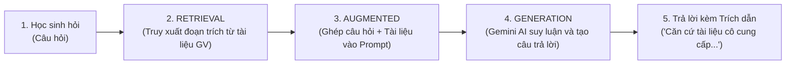

# BÁO CÁO TỔNG HỢP TOÀN DIỆN DỰ ÁN
## Hệ thống Trợ lý AI Ngữ Văn "Cô Dương dạy văn dễ thương"
**Thời gian cập nhật**: Tháng 10/2026  
**Nền tảng**: Node.js / Express (TypeScript), React (Vite / Tailwind CSS), PostgreSQL, Google Gemini AI (RAG Engine)

---

## I. TỔNG QUAN HỆ THỐNG & NGUYÊN LÝ RAG

### 1. Giới thiệu dự án
"Cô Dương dạy văn dễ thương" là giải pháp trợ lý học tập môn Ngữ văn thông minh dành cho học sinh THCS và THPT. Hệ thống giải quyết triệt để vấn đề "ảo giác" (hallucination - bịa thơ, chế dẫn chứng) của các mô hình ngôn ngữ lớn (LLM) thông thường bằng cách áp dụng nghiêm ngặt kiến trúc **RAG (Retrieval-Augmented Generation)**.

### 2. Kiến trúc RAG trong Chatbot Ngữ Văn
Khác với AI truyền thống chỉ dựa vào trí nhớ huấn luyện sẵn, chatbot hoạt động theo nguyên lý **"Mở sách giáo khoa / vở bài giảng của giáo viên"**:



* **R (Retrieval - Truy xuất)**: Khi học sinh hỏi bài, hệ thống tự động tìm kiếm trong kho bài giảng của cô giáo (đã được băm nhỏ thành các vector nhúng) những đoạn văn, dẫn chứng và nhận định sát nhất với câu hỏi.
* **A (Augmented - Tăng cường ngữ cảnh)**: Ghép câu hỏi của học sinh kèm các đoạn tài liệu tìm được thành một prompt có cấu trúc chặt chẽ, kèm yêu cầu phong cách sư phạm chuẩn mực ("xưng cô - gọi em").
* **G (Generation - Tạo sinh có kiểm chứng)**: Google Gemini AI phân tích dữ liệu được cấp để trả lời. Câu trả lời luôn kèm nhãn minh bạch: `Căn cứ tài liệu giáo viên` và `RAG Grounded ✓`.

---

## II. BẢNG TỔNG HỢP CÁC VẤN ĐỀ YÊU CẦU & SỰ CỐ ĐÃ XỬ LÝ

| STT | Vấn đề / Yêu cầu phát sinh | Nguyên nhân kỹ thuật | Giải pháp triển khai | Trạng thái |
|:---:|:---|:---|:---|:---:|
| **1** | **Khái niệm "Đang index..." & tài liệu "Ngoại tuyến"** | Quá trình băm nhỏ văn bản (chunking) và đồng bộ vector lên Google Gemini File Search cần độ trễ xử lý. | Giải thích cơ chế vector embedding; thiết lập thuật toán tìm kiếm cục bộ (fallback search) trích xuất tài liệu trực tiếp trên server để trả lời ngay cả khi Google File Search chưa hoàn tất index. | Hoàn thành |
| **2** | **Lưu Gemini API Key & nghi ngờ Mock AI** | Khóa API chỉ được lưu tạm thời trong biến môi trường tạm, chưa ghi vào cơ sở dữ liệu bền vững. | Thiết lập bảng `ai_settings` trong PostgreSQL. Thêm nút "Kiểm tra kết nối API" trực quan trong trang Admin để kiểm chứng kết nối thật tới máy chủ Google Gemini. | Hoàn thành |
| **3** | **Mất dữ liệu tác phẩm khi cập nhật web trên Render** | Render sử dụng ổ đĩa tạm thời (ephemeral disk). Khi rebuild hoặc khởi động lại, dữ liệu trên đĩa cục bộ bị xóa sạch. | Di chuyển toàn bộ dữ liệu (tác phẩm, tài liệu, lớp học, học sinh, lịch sử chat) sang cơ sở dữ liệu PostgreSQL bền vững trên Render (Managed PostgreSQL), tự động chạy migration khi khởi động. | Hoàn thành |
| **4** | **Tự sinh câu hỏi gợi ý & Tối ưu giao diện Mobile** | Khi chuyển tác phẩm, gợi ý không tự đổi; giao diện máy tính bị tràn khung khi xem trên điện thoại. | Xây dựng bộ gợi ý câu hỏi linh hoạt theo từng tác phẩm/thể loại (Truyện ngắn, Thơ, Ký...); thiết kế lại thanh điều hướng và menu ngăn kéo (Drawer/Sidebar vuốt chạm) chuẩn mobile-first. | Hoàn thành |
| **5** | **Quản lý lịch sử trò chuyện theo phiên & tài khoản** | Cần đảm bảo lịch sử hội thoại chỉ được lưu theo phiên đối với từng tài khoản riêng biệt để bảo mật học tập. | Thiết kế bảng `chat_sessions` và `chat_messages` gắn chặt với `user_id`. Cung cấp nút làm mới phiên chat và tự động xóa dữ liệu sau 24h hoặc khi học sinh bấm xóa phiên. | Hoàn thành |
| **6** | **Hỗ trợ thêm nhiều Gemini API Key (Key Pool)** | Tránh tình trạng cạn Quota hàng ngày (lỗi 429) hoặc gián đoạn dịch vụ từ Google (lỗi 503). | Xây dựng cơ chế **Key Pool**: cho phép nhập nhiều key (ngăn cách bằng dấu phẩy/xuống dòng), thuật toán Round-Robin luân phiên gọi key, tự động đưa key vào Cooldown 60s nếu quá tải và chuyển sang key dự phòng. | Hoàn thành |
| **7** | **Lỗi đổi mật khẩu lần đầu đăng nhập** | Học sinh nhập đúng mật khẩu ban đầu được cấp nhưng hệ thống báo lỗi không cho đổi. | Trong Express Router, `req.path` chỉ chứa `/change-password` khiến middleware hiểu nhầm và chặn `403 MUST_CHANGE_PASSWORD`. Đã sửa middleware nhận diện đường dẫn đầy đủ và hoãn nạp dữ liệu nền cho đến khi đổi xong mật khẩu. | Hoàn thành |
| **8** | **Phân cấp quản trị 2 cấp (Admin cấp 1 - Giáo viên cấp 2)** | Cần quyền xóa giáo viên, cấp quyền lớp cho giáo viên, quản lý lớp & học sinh toàn diện cho Admin; Giáo viên quản lý lớp được phân công. | - **Admin (Cấp 1)**: Thêm nút xóa giáo viên, modal phân công lớp, tab "Quản lý Lớp & Học sinh" xem/xóa học sinh và quản lý lớp toàn trường.<br>- **Giáo viên (Cấp 2)**: Thêm nút xóa học sinh trong các lớp mình dạy kèm kiểm tra quyền chặt chẽ. | Hoàn thành |
| **9** | **Sự cố màn hình trắng khi đăng nhập Admin** | Màn hình hiển thị màu trắng tinh, không nạp được giao diện sau khi đăng nhập tài khoản quản trị. | File `AdminDashboard.tsx` bị thiếu dòng import `useState, useEffect` từ `'react'` khiến React bị lỗi `ReferenceError`. Đã bổ sung import và cài đặt thêm `ErrorBoundary` toàn diện chống trắng màn hình. | Hoàn thành |
| **10** | **Lỗi sập tiến trình Node.js trên Render** | Render ghi nhận lỗi `column du.extra_granted does not exist` tại `getStudentsInClass` làm crash server. | Sửa câu truy vấn SQL liên kết đúng bảng `quota_extra_grants` (`SUM(extra_count)` thành `today_extra`), đồng thời bọc toàn bộ controller trong khối `try ... catch` an toàn. | Hoàn thành |

---

## III. MÔ HÌNH PHÂN CẤP QUẢN TRỊ (2 CẤP)

```mermaid
graph TD
    A["Admin (Cấp 1 - Quyền tối cao)"] -->|Toàn quyền hệ thống| B["Quản lý Giáo viên"]
    A -->|Toàn quyền trường học| C["Quản lý Lớp & Học sinh"]
    A -->|Hạ tầng kỹ thuật| D["Cấu hình AI Key Pool, Quota, Kill-Switch"]
    
    B -->|Xóa GV / Cấp quyền lớp dạy| E["Giáo viên (Cấp 2 - Phụ trách lớp)"]
    
    E -->|Quản lý học sinh thuộc lớp| F["Học sinh trong lớp"]
    E -->|Cấp thêm lượt hỏi bài (Quota)| F
    E -->|Xóa học sinh / Khóa / Reset mật khẩu| F
    
    C -->|Thêm, xóa lớp học| G["Danh mục lớp học"]
    C -->|Xem toàn bộ học sinh / Xóa học sinh| F
```

### 1. Quản trị viên (Admin - Cấp 1)
* **Quản lý Giáo viên**:
  * Tạo tài khoản giáo viên mới (kèm tùy chọn tài khoản giáo viên thử nghiệm).
  * Xóa tài khoản giáo viên (tự động thu hồi quyền quản lý lớp).
  * Phân công lớp dạy cho giáo viên thông qua giao diện hộp thoại (modal) chọn nhiều lớp trực quan.
* **Quản lý Lớp & Học sinh**:
  * Xem danh mục tất cả các lớp học trong toàn trường.
  * Tạo lớp mới hoặc xóa lớp trống.
  * Chọn xem danh sách học sinh của bất kỳ lớp nào trong trường.
  * Xóa học sinh hoặc đặt lại mật khẩu mặc định cho học sinh.
* **Cấu hình Hạ tầng & AI**:
  * Quản lý danh sách Gemini API Keys (Key Pool), kiểm thử từng key theo thời gian thực.
  * Thiết lập giới hạn câu hỏi ngày (Daily Quota), trần bảo vệ hệ thống (Hard Cap).
  * Kích hoạt công tắc khẩn cấp (Kill-Switch) khi cần bảo trì.

### 2. Giáo viên (Teacher - Cấp 2)
* **Quản lý Học sinh theo lớp phân công**:
  * Xem danh sách học sinh, trạng thái hoạt động, số câu hỏi đã dùng trong ngày.
  * Thêm học sinh thủ công hoặc nhập hàng loạt từ file Excel/CSV.
  * Xóa học sinh khỏi lớp được phân công (kèm kiểm tra phân quyền bảo mật).
  * Khóa / Mở khóa tài khoản học sinh; đặt lại mật khẩu về mặc định khi học sinh quên.
  * Cấp thêm lượt hỏi bài (Extra Quota) cho học sinh hiếu học hoặc cần ôn thi cấp tốc.
* **Quản lý Tài liệu & Tác phẩm**:
  * Đăng tải tài liệu bài giảng, hướng dẫn cảm thụ, dàn ý phân tích.
  * Phân quyền tài liệu cho các lớp học tương ứng.

---

## IV. BẢO MẬT & ĐỘ TIN CẬY CỦA HỆ THỐNG

1. **Mã hóa mật khẩu chuẩn Argon2id**: Mọi mật khẩu người dùng đều được băm bằng thuật toán Argon2id chống tấn công vét cạn và rò rỉ dữ liệu.
2. **Quy trình bắt buộc đổi mật khẩu lần đầu**: Khi học sinh/giáo viên được cấp tài khoản với mật khẩu ban đầu, hệ thống buộc người dùng phải tạo mật khẩu mới an toàn trước khi vào ứng dụng.
3. **Phòng vệ chống sập màn hình (Frontend ErrorBoundary)**: Component ErrorBoundary bắt trọn mọi ngoại lệ hiển thị và cung cấp giao diện khôi phục với nút "Tải lại trang", triệt tiêu lỗi màn hình trắng.
4. **Xử lý lỗi Backend chuẩn mực**: Tất cả các hàm điều khiển API đều được bảo vệ trong khối `try ... catch`, ghi vết Audit Logs minh bạch và phản hồi lỗi JSON rõ ràng.

---

## V. KẾT QUẢ KIỂM THỬ & TRIỂN KHAI

* **Backend Test Suite**: Vượt qua **19/19 bài kiểm thử** tự động (`vitest`):
  * `key_pool.test.ts`: Kiểm tra cân bằng tải và cơ chế Cooldown.
  * `rag_grounding.test.ts`: Kiểm tra tính trích dẫn và chống bịa đặt tài liệu.
  * `csv_import.test.ts`: Kiểm tra nhập danh sách học sinh từ file.
  * `auth.test.ts`: Kiểm tra băm mật khẩu Argon2id và xác thực phiên đăng nhập.
  * `quota.test.ts`: Kiểm tra giới hạn câu hỏi và chống lạm dụng.
* **Frontend Build**: Vite tối ưu toàn bộ mã nguồn với kích thước gzip ~124 kB.
* **Môi trường hoạt động**: Đã triển khai và hoạt động ổn định trên Render kết nối cơ sở dữ liệu PostgreSQL.
